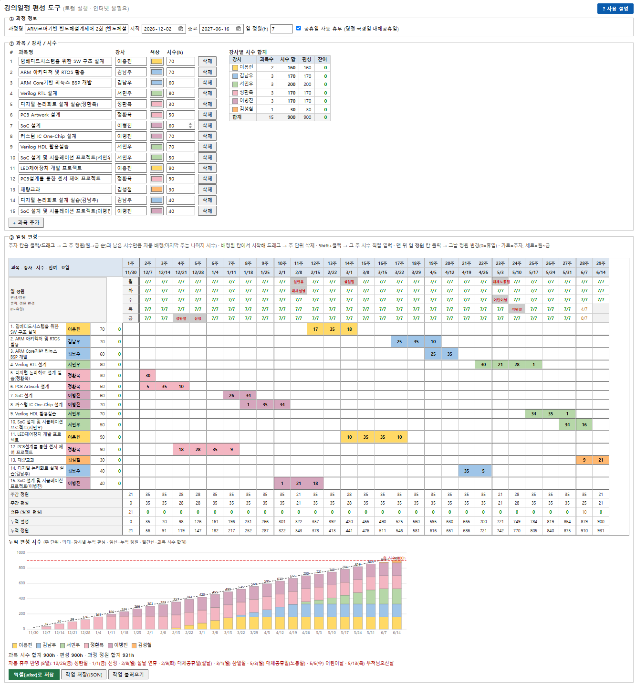

# GJ_TEACH_SCH

# 강의일정 편성 도구 사용 설명

과정 정보와 과목·강사·시수를 입력한 뒤, 격자에서 마우스로 날짜를 드래그해 일정을 편성하고 엑셀로 저장하는 도구입니다. 설치·인터넷 없이 이 파일만으로 동작합니다.

## 사용 흐름
* 과정 정보: 과정명, 시작·종료일, 일 정원(기본 7h)을 입력합니다.
* 과목 / 강사 / 시수: + 과목 추가로 행을 늘리고 과목명·강사·총 시수를 입력합니다. (한 과목을 여러 강사가 나누면 “(1)/(2)”처럼 과목을 둘로 나눠 입력)
* 일정 편성: 격자(과목 × 평일 날짜)에서 빈 칸을 클릭하거나 드래그합니다.
* 저장: 엑셀(.xlsx)로 저장을 누르면 파일이 내려받아집니다.

## 마우스 조작
| 동작	| 결과 | 
|-------------------|-------------------|
| 빈 칸 클릭 / 드래그	| 일 정원과 남은 시수만큼 자동 배정. 마지막 칸은 나머지 시수 (예: 130h → 7h×18일 + 4h) | 
| 배정된 칸에서 시작해 드래그	| 드래그한 구간 삭제 | 
| Shift + 클릭	| 그 칸의 시수를 직접 입력 (0 = 삭제) | 
| 날짜 머리글 클릭	| 그날 정원 변경 (0 = 휴일, 회색 표시) | 

* 같은 날 다른 과목이 이미 시간을 쓰고 있으면 남은 시간만 배정됩니다. 드래그는 같은 과목 행 안에서만 적용됩니다.

## 화면 표시 읽는 법
 * 노란 칸: 배정된 시수    회색: 휴일/정원 0
* 왼쪽 잔여: 0 = 완료, 양수 = 더 배정 필요, 음수 = 초과
* 맨 아래 일 편성 / 정원: 초록 = 정원 충족, 주황 = 남음, 빨강 = 초과
* 격자 아래 요약: 과목 시수 합계 · 편성 합계 · 과정 정원 합계 (정원이 부족하면 경고)

## 엑셀 출력 구성
* 강의일정 시트: 주차별(월~금) 정원 → 합계 → 검증(합계−편성) → 편성 → 과목별 주간 시수. 합계·검증·편성은 수식이며, 검증이 0이 아니면 빨간색, 과목 합계가 시수와 다르면 분홍색으로 표시됩니다.
* 일별 시트: 과목별 일자 단위 시수와 일 합계.
* 수식 값은 엑셀에서 파일을 열 때 계산됩니다.

## 강사별 색상
* 과목 표의 색상 칸에서 강사 색을 고르면 격자의 배정 칸, 강사 칸, 엑셀 출력에 그 색이 적용됩니다.
* 강사 이름이 같으면 한 번 선택으로 모든 과목에 동일하게 적용됩니다. 새 강사 이름을 입력하면 겹치지 않는 색이 자동으로 지정됩니다.
* 엑셀에서는 강의일정·일별 시트의 강사 칸과 시수가 있는 칸에 색이 칠해집니다.

## 공휴일 자동 휴무
* "공휴일 자동 휴무"를 켜 두면 기간 내 신정·설날 연휴·삼일절·노동절·어린이날·부처님오신날·현충일·제헌절·광복절·추석 연휴·개천절·한글날·성탄절·선거일이 자동으로 정원 0(휴일)이 됩니다. 노동절·제헌절은 2026년부터 공휴일로 적용됩니다.
* 대체공휴일도 자동 계산됩니다. 설날·추석 연휴가 일요일 또는 다른 공휴일과 겹치면, 그 밖의 공휴일은 토·일요일 또는 다른 공휴일과 겹치면 다음 첫 평일이 대체공휴일입니다. 신정·현충일은 대체공휴일이 없습니다.
* 휴일 칸은 회색이며 날짜 아래에 이름이 빨간 글씨로 표시되고, 격자 아래에 목록이 나옵니다. 엑셀에서는 해당 날 정원 칸이 비고, 일별 시트 머리글에 이름이 표시되며 강의일정 시트 하단에 휴일 목록이 적힙니다.
* 음력 명절(설날·추석·부처님오신날)은 브라우저 음력 달력으로 계산합니다(크롬/엣지 권장). 2026·2027년은 우주항공청 월력요항 기준과 대조했습니다.
* 임시공휴일, 새로 생긴 선거일, 학원·기관 자체 휴무일은 자동 반영되지 않습니다. 날짜 머리글을 클릭해 0을 입력하세요. 휴일에 수업해야 하면 같은 방법으로 정원을 7로 입력하면 됩니다.

## 저장 / 불러오기
* 작업 내용은 이 브라우저에 자동 저장됩니다 (브라우저 데이터를 지우면 사라짐).
* 작업 저장(JSON) / 작업 불러오기로 파일로 보관하거나 다른 PC로 옮길 수 있습니다.
* 기간을 바꾸면 기간 밖 날짜의 배정은 삭제됩니다.
